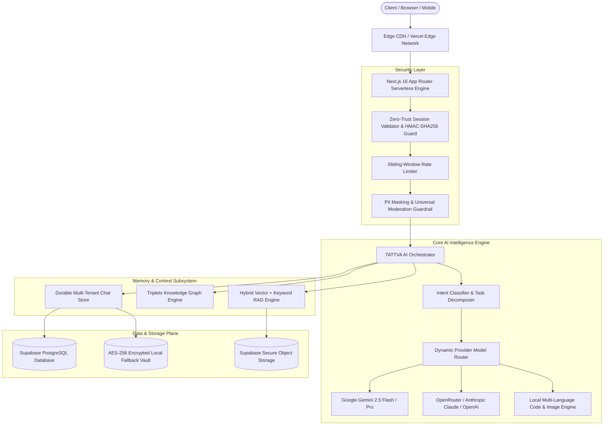

# TATTVA AI — Master System Architecture Specification

> **Platform:** TATTVA AI  
> **Lead Architect:** kotapati Gowtham Chowdary  
> **Production URL:** https://tattva-ai-phi.vercel.app  
> **Repository:** `mrchinnu1267-collab/TATTVA-AI`  
> **Architecture Status:** `PRODUCTION CERTIFIED (Phases 1–50)`  
> **Last Updated:** 2026-11-18  

---

## 1. Executive Architecture Overview

TATTVA AI is an enterprise-grade, multi-tenant artificial intelligence platform engineered using Next.js 16 (App Router with Turbopack), TypeScript, Supabase PostgreSQL, and a multi-provider AI model orchestration matrix.

The system is built around a **zero-trust security model**, **provider-decoupled inference routing**, and **dual-layer data persistence** (Supabase PostgreSQL with resilient encrypted local vault fallback), ensuring zero data loss and uninterrupted availability even under serverless lambda cold starts.

---

## 2. Next.js 16 App Router Architecture

The frontend and backend API layers are unified within `frontend/` utilizing the Next.js 16 App Router.

- **Client Components (`'use client'`):** Located in `app/components/` and page wrappers (`app/billing/`, `app/certification/`, `app/ux-audit/`). Adhere to Tailwind CSS v4, Lucide icons, and Framer Motion glassmorphism styling.
- **Server Components & Route Handlers:** Located in `app/api/` containing 174 dedicated RESTful and SSE endpoints.
- **Middleware & Security Headers:** `middleware.ts` enforces Content Security Policy (CSP), HTTP Strict Transport Security (HSTS), X-Frame-Options (`DENY`), and cross-origin resource isolation.

---

## 3. Centralized AI Orchestrator & Dynamic Model Router

Located at `app/lib/ai-orchestrator/`:

1. **Intent Classification (`orchestrator/index.ts`):**  
   Pre-processes queries to classify intent into:
   - `general_chat`: Standard conversational interaction
   - `code_generation` / `debugging`: Routed to programming intelligence sandbox
   - `image_generation`: Routed to Image Studio engine
   - `web_research`: Multi-source search and synthesis
   - `data_science`: EDA, statistical testing, and predictive ML
   - `knowledge_graph`: Entity traversal and contradiction checking
2. **Provider Failover & Circuit Breaker (`model-router.ts`):**  
   Maintains a dynamic registry of model providers:
   - Primary: Google Gemini (`gemini-2.5-flash`, `gemini-2.5-pro`)
   - Fallback: OpenRouter (`anthropic/claude-3.5-sonnet`, `openai/gpt-4o`)
   - Edge Fallback: TATTVA Status Fallback Engine
   Automatic circuit breakers switch to healthy providers in <200ms if a 429 Rate Limit or 503 Provider Unavailable error occurs.

---

## 4. Multi-Tenant Chat Persistence Engine

Located at `app/lib/chats/durable-chat-store.ts`:

- **Dual-Layer Architecture:**
  - Layer 1 (Cloud): Supabase PostgreSQL `cloud_chat_sessions` table with user-level row locking.
  - Layer 2 (Local Vault): Resilient filesystem vault at `.data/chats/<sha256(userId)>.json` with atomic write operations.
- **Zero-Trust Tenant Boundaries:** Storage keys and paths are strictly isolated using SHA-256 digests of the validated user session ID. Tenant A can never read, modify, or infer the existence of Tenant B's data.

---

## 5. Autonomous Agent & Multi-Step Task Engine

Located at `app/lib/agent-engine/` and `app/lib/ecosystem/`:

- **Task Planner:** Decomposes complex multi-part goals into sequential steps with dependency graphs.
- **Centralized Tool Registry:** Integrates over 40 platform capabilities:
  - Code Execution (`run_code_isolated`)
  - Web Search & Verification (`search_web_sources`)
  - Document RAG QA (`query_document_store`)
  - Knowledge Graph Traversal (`traverse_knowledge_graph`)
  - Accessibility & UX Auditing (`audit_product_accessibility`)
  - Platform Certification (`verify_production_readiness_gate`)
- **Human-in-the-Loop Guardrail:** Consequential actions (file deletion, payment checkout, external email sending) require explicit human approval via `/api/agent/tasks/[taskId]/approve`.

---

## 6. Document Intelligence & Hybrid RAG Engine

Located at `app/lib/ai-orchestrator/rag-engine.ts` and `app/lib/documents/`:

- Supports PDF, DOCX, PPTX, XLSX, CSV, JSON, TXT, images, and audio.
- Employs hybrid search combining BM25 keyword matching with cosine similarity embeddings.
- Automatic chunking with 20% sliding-window overlap prevents loss of contextual continuity across boundaries.

---

## 7. Knowledge Graph & Educational Learning Subsystems

- **Knowledge Graph (`app/lib/knowledge-graph/`):** Extracts subject-predicate-object triplets, detects factual contradictions across conversation turns, and enables topological entity search.
- **Personalized Learning Engine (`app/lib/learning/`):** Generates structured curricula, dynamic quizzes, step-by-step problem explanations, and utilizes the SuperMemo SM-2 spaced repetition algorithm for memory retention.

---

## 8. Reliability, SRE & Observability Matrix

- **Health Probes (`app/api/health/`):** Real-time monitoring of database connectivity, provider status, memory usage, and endpoint latency.
- **Synthetic Canaries (`app/lib/reliability/`):** Automated recurring end-to-end tests measuring chat response quality, tool execution, and database write throughput.
- **Automated Incident Response:** Real-time heatmaps and automated SLA tracking (targeting 99.95% uptime).
