# TATTVA AI — Master Deployment Log & Release Operations Manual

> **Production Domain:** https://tattva-ai-phi.vercel.app  
> **Platform Provider:** Vercel (Edge Network + Serverless Lambdas)  
> **Git Remote:** `https://github.com/mrchinnu1267-collab/TATTVA-AI.git`  
> **Active Production Commit:** `ccae132`  
> **Deployment Status:** `ACTIVE & HEALTHY`  
> **Last Updated:** 2026-11-18  

---

## 1. Deployment Architecture & Release Process

Every release to TATTVA AI adheres to a strict, multi-stage deployment pipeline:

```mermaid
flowchart LR
    Dev[Feature Branch] --> LocalQA[Local Tests & TypeCheck]
    LocalQA --> GitPush[Push to Origin Feature Branch]
    GitPush --> PreviewDeploy[Vercel Preview Deployment]
    PreviewDeploy --> PreviewVerification[Automated Harness on Preview URL]
    PreviewVerification --> MergeMain[Merge to main branch]
    MergeMain --> ProdDeploy[Vercel Production Deployment]
    ProdDeploy --> LiveVerification[Live Production Verification]
```



---

## 2. Recent Deployment History

### Deployment `dpl_9aRFJH1tHZ4XUyjNWafpuAuyRrEP` (Current Production)
- **Date & Time:** 2026-11-18T04:43:00Z
- **Target:** `production` (`https://tattva-ai-phi.vercel.app`)
- **Git Commit:** `ccae132`
- **Branch:** `main`
- **Release Highlights:**
  - Implemented Unified Multi-Modal Model Registry (`model-registry.ts`) with Gemini, Claude, OpenAI, DeepSeek, and Nvidia NIM fleets
  - Dynamic Capability Scoring algorithm balancing intent alignment, modality compatibility, context token limits, and cost sensitivity
  - Live Circuit Breaker health tracking (trips after 3 consecutive failures, 60s cooldown, automatic half-open recovery)
  - Implemented Dynamic Execution Planner (`execution-planner.ts`) with Kahn's algorithm topological execution tiers and dynamic variable binding (`{{step_1.output.summary}}`)
  - Enforced zero-trust Human-In-The-Loop approval gates on dangerous/destructive operations (`DROP TABLE`, `rm -rf`)
  - Added RESTful API route handlers `GET /api/models/registry` and `POST|GET /api/agent/plan` with zero-trust HMAC session authorization
- **Verification Result:** 10/10 automated production verification checks PASSED (100%).

### Deployment `dpl_5abdSeYwAYWBkrEuXtHbzjtCFFh5` (Previous Production)
- **Date & Time:** 2026-11-18T04:18:22Z
- **Target:** `production` (`https://tattva-ai-phi.vercel.app`)
- **Git Commit:** `18f5ea3`
- **Branch:** `main`
- **Release Highlights:**
  - Upgraded Phase 7 Universal Multi-Tenant Cognitive Memory Engine (`memory-service.ts`, `memory-types.ts`, `api/memory/route.ts`)
  - Isolated multi-tenant storage via SHA-256 partition directories (`.data/memories/<sha256(user)>/`) with atomic write replacements
  - Added 5-Category Cognitive Taxonomy (`short_term`, `long_term`, `project`, `preference`, `organizational`) with automated TTL pruning
  - Added GDPR-compliant Markdown and structured JSON cognitive profile exports
  - Hardened `/api/memory` with zero-trust session identity checks and anti-spoofing rejection
- **Verification Result:** 9/9 automated production verification checks PASSED (100%).

### Deployment `dpl_CKECmW1uKvyDG8FSUXj74ZrDMZsW` (Preview Staging)
- **Date & Time:** 2026-11-18T04:14:10Z
- **Target:** `preview` (`https://tattva-pshbqiw98-gowthamchowdary1267-5698.vercel.app`)
- **Git Commit:** `18f5ea3`
- **Branch:** `feature/universal-multi-tenant-memory-engine`
- **Verification Result:** 9/9 staging verification checks PASSED (100%).

### Deployment `dpl_3xZXggEWXEs866QdpEU3dow36Vcn` (Previous Production)
- **Date & Time:** 2026-11-18T03:51:47Z
- **Target:** `production` (`https://tattva-ai-phi.vercel.app`)
- **Git Commit:** `8f07718`
- **Branch:** `main`
- **Release Highlights:**
  - Integrated Durable Multi-Tenant Cloud Chat Persistence Store (`durable-chat-store.ts`)
  - Universal Pre-Execution Content Moderation Guardrail in AI Orchestrator
  - Hardened `/api/chats` route handler with zero-trust session validation
  - Corrected timezone and safety check test assertions
  - Updated Master Roadmap Status Tracker
- **Verification Result:** 8/8 automated production verification checks PASSED.

### Deployment `dpl_AQJrwLRM221qE2C18rkAjN1dF1gz` (Preview Staging)
- **Date & Time:** 2026-11-18T03:47:05Z
- **Target:** `preview` (`https://tattva-fgq4aqzei-gowthamchowdary1267-5698.vercel.app`)
- **Git Commit:** `247ffa1`
- **Branch:** `feature/durable-chat-persistence-reliability`
- **Verification Result:** 8/8 staging verification checks PASSED.

### Deployment `dpl_1xrm8vejp` (Phase 50 Certification Release)
- **Date & Time:** 2026-11-18T03:16:22Z
- **Target:** `production`
- **Git Commit:** `0575fb2`
- **Release Highlights:** Platform Completion & Final Production Certification across all 50 roadmap milestones.

---

## 3. Mandatory Production Release Gates

Before any production release is authorized, all following conditions must be met:
1. `npx tsc --noEmit` exits with status `0`.
2. All unit and integration test suites pass at 100%.
3. Vercel Preview deployment builds without error.
4. Preview verification harness passes all health, auth, and data isolation checks.
5. Zero destructive database migrations or schema alterations without verified snapshots.
6. A verified rollback target commit hash is identified.

---

## 4. Rollback Runbook

In the event of an unexpected regression, degraded response latency, or service disruption in live production:

1. **Immediate Vercel Rollback:**
   ```bash
   npx vercel rollback https://tattva-ai-phi.vercel.app
   ```
   Or promote the previously verified deployment via Vercel CLI:
   ```bash
   npx vercel promote <previous-deployment-id>
   ```
2. **Git Branch Reversion:**
   ```bash
   git checkout main
   git revert HEAD -m "revert: rollback to previous verified production commit"
   git push origin main
   ```
3. **Database State Verification:**
   Inspect Supabase PostgreSQL connection and verify tenant record integrity. Local encrypted fallback storage ensures continuous operation during upstream database recovery.
