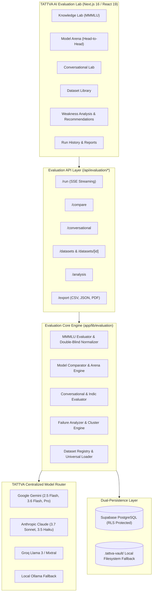
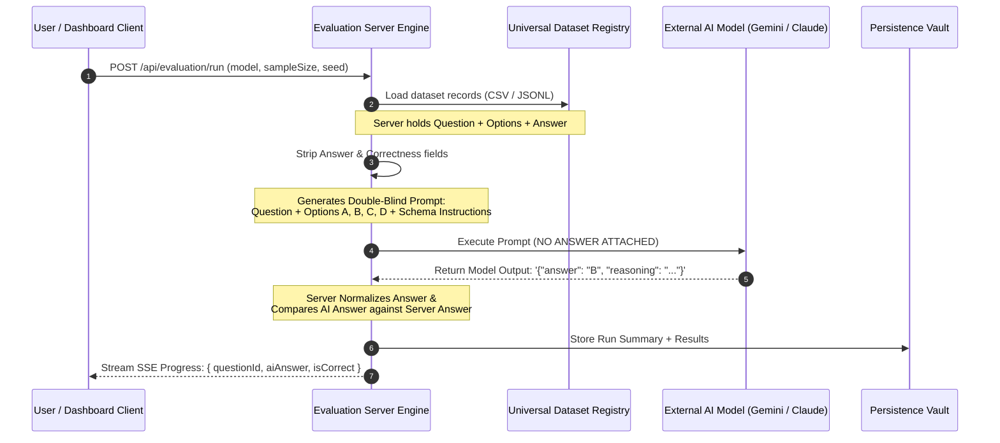

# TATTVA AI — AI Evaluation & Intelligence Development System Architecture
**Conceptualized & Engineered by kotapati Gowtham Chowdary**

---

## 1. Executive Overview

The **TATTVA AI Evaluation & Intelligence Development System** is an enterprise-grade empirical benchmarking, model comparison, failure analysis, and continuous alignment framework integrated into the TATTVA AI foundation ecosystem.

Rather than treating AI evaluation as a superficial prompt-response checker, TATTVA AI implements a rigorous, double-blind scientific evaluation harness that measures empirical capability across:
1. **Academic Knowledge & Reasoning** (OpenAI MMMLU Hindi benchmark — 14,042 questions across 57 subjects).
2. **Native Indic Multilingual Understanding** (Telugu reasoning, IndicQA, and Telugu-English conversational code-switching).
3. **Multi-Constraint Instruction Adherence** (JSON schema compliance, negative constraints, word limits).
4. **Conversational Multi-Turn Memory** (Context retention across turns, reference resolution, topic shifts).
5. **Head-to-Head Model Arena Benchmarking** (Deterministic seed parity, delta matrices, cross-model consensus).
6. **Continuous Failure Clustering & Human-Approved Improvements** (Automated error diagnostics with strict human-in-the-loop review governance).



---

## 2. Double-Blind Answer Security Architecture

A foundational principle of the TATTVA evaluation engine is **absolute ground-truth isolation**:

> **CRITICAL SECURITY INVARIANT:**
> The ground-truth answer letter (`A`, `B`, `C`, `D`), expected explanation, and evaluation rubrics are **NEVER** transmitted to the AI model during inference, and are **NEVER** leaked to unauthenticated client requests prior to evaluation completion.

### Request Isolation Flow



### Prompt Normalization & Extraction Heuristics

The prompt builder (`app/lib/evaluation/mmmlu/evaluator.ts`) formats every question with an explicit, rigid JSON output schema instruction:
```json
{
  "answer": "A | B | C | D",
  "confidence": 0.95,
  "reasoning": "Brief justification"
}
```

The response normalizer executes a 4-tier cascade to resolve answers even if models emit verbose conversational text:
1. **Strict JSON Parsing**: Extracts `answer` key and normalizes uppercase.
2. **Regex Prefix Extraction**: Detects `(?:\b(?:option|choice|answer|उत्तर|సమాధానం)\s*[:=\-–]?\s*([A-D])\b)`.
3. **First Valid Option Extraction**: Scans first 50 characters for isolated option letter `\b([A-D])\b`.
4. **Invalid Marker**: If no option letter is decipherable, marks response as `INVALID` with `0.0` accuracy attribution.

---

## 3. Dual-Persistence Architecture

TATTVA AI operates reliably across both high-availability production cloud deployments and isolated offline development environments via its **Dual-Persistence Engine**:

1. **Primary Cloud Layer (Supabase PostgreSQL)**:
   - Relational tables: `datasets`, `evaluation_runs`, `evaluation_results`, `model_comparisons`, `improvement_recommendations`, `conversational_evaluations`.
   - Protected by Row-Level Security (RLS) guaranteeing that user evaluations remain private to the authenticated tenant.
   - Performance indexing on `(model, created_at DESC)` and `(subject, is_correct)`.

2. **Offline Fallback Layer (`.tattva-vault/`)**:
   - Resilient filesystem storage at `.tattva-vault/evaluations/`, `.tattva-vault/comparisons/`, `.tattva-vault/improvements/`, `.tattva-vault/conversational/`.
   - On serverless environments (e.g., Vercel / AWS Lambda), dynamically routes to `/tmp/.tattva-vault/`.
   - Guarantees 100% operational availability even if database credentials are not yet configured.

---

## 4. Real-Time Streaming & Lifecycle Management

Evaluations of large sample sizes (e.g., 100–456 questions) utilize HTTP Server-Sent Events (SSE) streaming for real-time dashboard responsiveness:

- **SSE Endpoint**: `POST /api/evaluation/run` with `stream: true`.
- **Event Dispatch**:
  - `progress`: Dispatched after each question completes (`current`, `total`, `accuracy`, `latestResult`).
  - `complete`: Emits the final `EvaluationRunSummary` with full subject breakdown.
  - `error`: Dispatched on unrecoverable stream failures.
- **Cancellation**:
  - Client can issue `POST /api/evaluation/stop` with `{ runId }`.
  - The server terminates the active `AbortController` and signals worker promises to halt gracefully without corrupting partial results.

---

## 5. Architectural Directory Mapping

```text
TATTVA_AI/
├── datasets/                                 # Canonical Benchmark Datasets
│   ├── datasets-manifest.json                # Universal Dataset Manifest
│   ├── MMMLU/                                # Hindi MMMLU Corpus (Sample & Full)
│   ├── multilingual/                         # Telugu Reasoning & Indic QA
│   ├── instruction/                          # Multi-Constraint Adherence
│   └── conversational/                       # Multi-Turn Dialogue & Code-Switching
├── docs/                                     # System Documentation Suite
│   ├── AI_EVALUATION_ARCHITECTURE.md
│   ├── DATASET_MANAGEMENT.md
│   ├── MODEL_COMPARISON.md
│   ├── PERFORMANCE_IMPROVEMENT.md
│   ├── MULTILINGUAL_EVALUATION.md
│   ├── EVALUATION_API.md
│   └── EVALUATION_USER_GUIDE.md
├── frontend/
│   ├── app/
│   │   ├── api/evaluation/                   # Next.js 16 REST & SSE Endpoints
│   │   ├── evaluation/                       # Dashboard UI & Tabs
│   │   │   ├── page.tsx                      # Master Evaluation Lab
│   │   │   └── components/                   # Modular Evaluation Tab Panes
│   │   └── lib/evaluation/                   # Pure Engine Modules
│   │       ├── datasets/                     # Universal Loader & Registry
│   │       ├── mmmlu/                        # MMMLU Evaluator, Storage, Exporter
│   │       ├── comparison/                   # Head-to-Head Arena & Delta Engine
│   │       ├── improvement/                  # Weakness Clustering & Recommendations
│   │       └── conversational/               # Multi-Turn Indic Evaluator
│   └── tests/                                # Automated Evaluation Test Suites
└── supabase_evaluation_schema.sql            # PostgreSQL RLS Database Schema
```

---
*Created by kotapati Gowtham Chowdary for TATTVA AI Foundation Ecosystem.*
