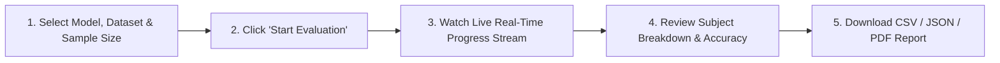

# TATTVA AI — Evaluation Lab User Guide
**Conceptualized & Engineered by kotapati Gowtham Chowdary**

---

## 1. Introduction

Welcome to the **TATTVA AI Evaluation Lab**! This dashboard allows you to measure, benchmark, compare, and improve AI model intelligence using empirical scientific datasets, including the OpenAI MMMLU Hindi benchmark (14,042 questions across 57 academic subjects) and native Indic reasoning benchmarks.

To open the Evaluation Lab:
- Navigate to `/evaluation` in your browser, or
- Click the **AI Evaluation Lab** button from the main TATTVA AI navigation bar.

---

## 2. Navigating the Dashboard Tabs

The Evaluation Lab header provides 6 specialized tabs:

| Tab | Icon | Purpose |
| :--- | :---: | :--- |
| **Knowledge Lab (MMMLU)** | 🧠 | Configure and run academic knowledge benchmarks on individual models. |
| **Model Arena** | ⚔️ | Fair side-by-side battle between two models on identical questions and seeds. |
| **Conversational Lab** | 💬 | Multi-turn dialogue evaluation, context retention, and Telugu code-switching. |
| **Dataset Library** | 🗄️ | Inspect registered benchmarks, view question schemas, and toggle active status. |
| **Weakness Analysis** | 💡 | Review failure clusters and approve/reject actionable improvement recommendations. |
| **History** | 🕒 | Browse, inspect, and export past evaluation reports. |

---

## 3. Running an Evaluation in the Knowledge Lab

### Step 1: Configure Your Benchmark
1. **Target Model**: Select an available AI model (e.g. `Gemini 2.5 Flash`, `Gemini 3.6 Flash`).
2. **Dataset**: Choose `Sample (456 Questions)` for rapid checks, or `Full Corpus (14,042 Questions)` for deep testing.
3. **Sample Size Preset**: Quick buttons for `10`, `25`, `50`, `100`, `250`, `456`, or `All`.
4. **Subject Filter**: Select `all` (recommended for balanced testing) or isolate a single subject (e.g. `elementary_mathematics`, `high_school_physics`).
5. **Concurrency**: Set parallel worker count (`1` to `5`).
6. **PRNG Seed**: Leave empty for random sampling, or enter a number (e.g., `42`) for 100% reproducible question selection.

### Step 2: Start and Monitor Execution
- Click **Start Evaluation**.
- Watch the live metric cards update in real time:
  - **Total Questions & Attempted**: Shows overall completion percentage.
  - **Verified Correct Hits (Green)** and **False Choices (Red)**.
  - **Empirical Accuracy Gauge**: Updates dynamically as responses arrive.
  - **Average Latency**: Tracks response times per question.
- Use **Stop Evaluation** at any time to pause or cancel.

### Step 3: Inspect Question Results Table
- Filter results by status: `All`, `Correct Only`, `Incorrect Only`, or `Invalid Format`.
- Search questions by keyword.
- Expand any question row to view the full prompt, AI model reasoning, latency, and verified answer.

---

## 4. Using the Model Arena

1. Switch to the **Model Arena** tab.
2. Select **Model A (Defender)** and **Model B (Challenger)**.
3. Pick a sample size (e.g., `25`) and enter a seed (e.g., `42`).
4. Click **Start Arena Battle**.
5. When complete, inspect the **Winner Podium Banner** to see which model prevailed and why.
6. Review the **Question Delta Matrix** to see exact questions where the models agreed or diverged.

---

## 5. Reviewing Weakness Recommendations

1. Switch to the **Weakness Analysis** tab.
2. Inspect failure clusters identified by the analyzer (e.g., `Answer Formatting Malformation`, `Subject Knowledge Gap`).
3. For each recommendation, review the **Actionable Step** and the **Supporting Failure Evidence**.
4. Use the governance buttons:
   - **Approve**: Authorize the improvement for engineering implementation.
   - **Reject**: Dismiss recommendations that are noisy or low priority.
   - **Mark Implemented**: Confirms the prompt adjustment or routing change has been tested and deployed.

---

## 6. Exporting Reports

Click any of the export buttons in the top right header:
- **CSV**: Download a spreadsheet with question-by-question model answers, ground truth, latencies, and subject tags.
- **JSON**: Machine-readable full evaluation payload for automated CI/CD pipelines.
- **PDF Report**: Formatted executive summary ready for distribution.

---
*Created by kotapati Gowtham Chowdary for TATTVA AI Foundation Ecosystem.*
