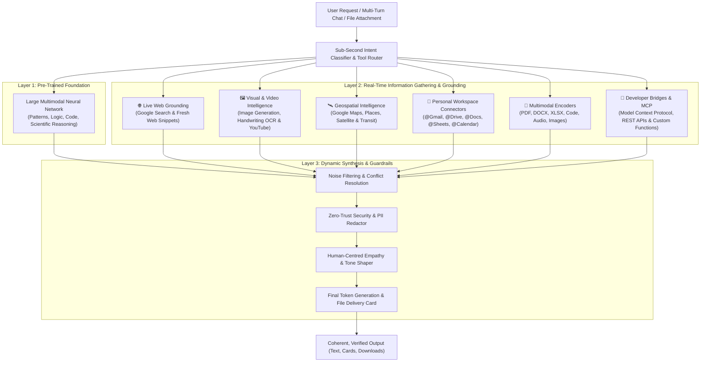

# TATTVA AI — Dynamic Information Gathering & Multi-Layer Neural Architecture

> **Architect & Lead Engineer:** kotapati Gowtham Chowdary  
> **Platform:** TATTVA AI (Web, Mobile, Desktop)  
> **Updated:** 2026-11-14

---

## Executive Overview

When a user submits a query to TATTVA AI, the system does not simply pull a single pre-written paragraph from a static database. Instead, TATTVA AI operates like a real-time research analyst paired with a massive neural library, dynamically deciding how to gather, verify, and weave information together from multiple distinct layers.

---

## 1. The Foundation: Pre-Trained Neural Knowledge

At the core of TATTVA AI is a large multimodal neural network trained across the spectrum of human knowledge—spanning computer algorithms, scientific literature, mathematics, encyclopedias, and multilingual corpora. 

Rather than storing documents like folders on a hard drive, concepts, mathematical laws, and language relationships are encoded directly into neural weights. When asked about timeless principles—such as balancing a binary search tree, thermodynamics, or designing resilient software architectures—TATTVA AI generates answers directly from this internal reasoning engine, predicting and assembling concepts token by token.

---

## 2. Reaching Beyond Static Memory: Real-Time Grounding

Because static neural training cannot access private files or live real-world updates, TATTVA AI relies on active grounding and retrieval systems:

### 2.1 Live Web Grounding (Google Search & URL Context)
For current events, breaking developments, live weather, or shifting software specifications, targeted search queries are dispatched in milliseconds. TATTVA AI inspects top-ranking sources, cross-references conflicting reports, and grounds responses in verified data.

### 2.2 Visual and Video Intelligence (Image Generation & YouTube)
Concepts that require visual clarity (e.g., system topologies, circuit diagrams, architectural layouts) trigger visual synthesis or real-world image retrieval. Through YouTube integration, video transcripts and metadata are parsed to produce actionable summaries without requiring manual viewing.

### 2.3 Geospatial and Satellite Mapping (Google Maps & Places)
For queries tied to real-world locations, transit, businesses, or facilities, geospatial databases supply live operating hours, customer reviews, coordinates, and direct links to TATTVA Satellite Maps.

### 2.4 Personal Workspace Connectors (Gmail, Drive, Docs, Sheets, Calendar)
When authorized via Connected Apps, TATTVA AI securely accesses private user workspaces. Queries regarding project deadlines, draft meeting notes, or spreadsheet figures are fulfilled by retrieving only the necessary context directly from the user's workspace.

### 2.5 Multimodal Input & Universal File Parsers
Uploaded PDFs, code scripts, spreadsheets, audio notes, and handwritten whiteboard photos pass through specialized multimodal vision and document encoders. Pixels, document hierarchies, and waveforms are analyzed in a unified context window.

### 2.6 Custom Developer Bridges (Function Calling & Model Context Protocol)
Through standard JSON Schemas and the Model Context Protocol (MCP), TATTVA AI interfaces with live databases, third-party REST endpoints, and IoT telemetry streams on demand.

---

## 3. Dynamic Synthesis & Execution Pipeline

1. **Millisecond Routing:** Evaluates user intent and decomposes complex tasks into required tools.
2. **Parallel Dispatch:** Dispatches necessary tool calls simultaneously across web, vision, workspace, or database layers.
3. **Filtering & Verification:** Evaluates returned data, removes noise, and flags contradictions.
4. **Human-Centred Assembly:** Synthesizes verified facts into an authoritative, empathetic response formatted as structured prose, interactive UI widgets, or authentic downloadable files.
