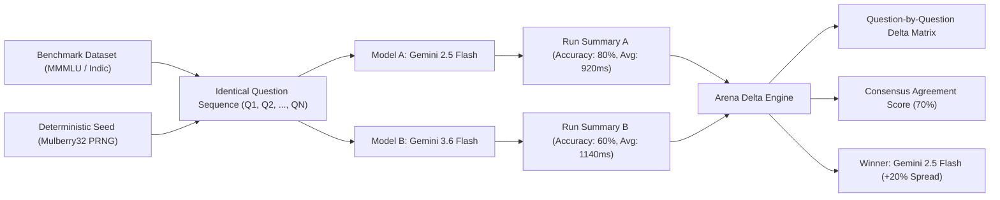

# TATTVA AI — Advanced Model Comparison & Benchmark Arena
**Conceptualized & Engineered by kotapati Gowtham Chowdary**

---

## 1. Overview & Core Philosophy

The **TATTVA Model Comparison Arena** allows developers, researchers, and stakeholders to evaluate multiple foundation models side-by-side on identical empirical benchmarks.

In competitive LLM evaluations, uncontrolled variables often skew benchmark outcomes (e.g., testing Model A on one random subset of questions while Model B gets another subset, or varying prompt structures). TATTVA AI enforces **Strict Fair Benchmark Conditions** so that any observed difference in performance is attributable solely to model capability.



---

## 2. Fair Benchmark Constraints

Whenever a comparison is executed via `POST /api/evaluation/compare` or `modelComparator.executeComparison()`, the engine enforces:

1. **Identical Question Parity**:
   - The same questions in the exact same order are supplied to every model.
   - Question subsampling utilizes the deterministic **Mulberry32 PRNG** seeded with the user-provided integer seed (default: `42`).

2. **Identical System Prompt & Schema Framing**:
   - Every model receives the exact same system instructions, option formatting, and JSON response schema.

3. **Double-Blind Isolation**:
   - No model receives prior answers from another model.
   - Ground truth is kept strictly server-side.

---

## 3. Winner Determination Algorithm

The arena engine computes the winner based on a strict multi-tier hierarchy:

$$\text{Winner} = \begin{cases} \text{argmax}(\text{Accuracy}), & \text{if } |\Delta_{\text{accuracy}}| > 0 \\ \text{argmin}(\text{AvgLatencyMs}), & \text{if } |\Delta_{\text{accuracy}}| = 0 \\ \text{Tie}, & \text{if } |\Delta_{\text{accuracy}}| = 0 \text{ and } |\Delta_{\text{latency}}| < 50\text{ms} \end{cases}$$

- **Primary Criterion**: Empirical accuracy on verified dataset answers.
- **Secondary Criterion (Tie-Breaker)**: Average inference latency in milliseconds.
- **Accuracy Spread**: The percentage point difference between the winner and runner-up:
  $$\text{Spread} = \text{Accuracy}_{\text{winner}} - \text{Accuracy}_{\text{runner-up}}$$

---

## 4. Cross-Model Consensus & Question Delta Matrix

For each question $i$, the engine records the answer provided by each model and determines whether a **consensus** exists:

- **Unanimous Agreement**: All models selected the same option letter.
- **Majority Consensus**: The option letter selected by the highest number of models.
- **Agreement Score**:
  $$\text{Agreement Score} = \left(\frac{\sum_{i=1}^{N} \mathbb{I}(\text{Unanimous Agreement}_i)}{N}\right) \times 100\%$$

### Delta Matrix Structure (`QuestionComparisonDelta`)

```typescript
export interface QuestionComparisonDelta {
  questionId: number | string;
  question: string;
  subject: string;
  expectedAnswer?: string;
  modelAnswers: Record<string, {
    aiAnswer: string;
    isCorrect: boolean;
    latencyMs: number;
    explanation?: string;
    status: string;
  }>;
  consensusAnswer?: string;
  unanimousAgreement: boolean;
}
```

---

## 5. Model Arena Dashboard UI (`ModelComparisonTab.tsx`)

The **Model Arena** tab in the Evaluation Lab provides an interactive view:
- **Challenger vs Defender Model Pickers**: Dropdown selector of configured models.
- **Sample Size & Seed Inputs**: Presets for 10, 25, 50, 100, or custom seeds.
- **Live Battle Execution**: Real-time progress indicators for both models.
- **Winner Podium Banner**: Highlights the superior model with metrics and explanation.
- **Interactive Question Delta Table**: Filter by "Both Correct", "Challenger Won", "Defender Won", or "Disagreements Only".

---
*Created by kotapati Gowtham Chowdary for TATTVA AI Foundation Ecosystem.*
