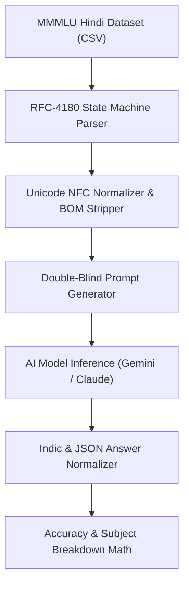

# TATTVA AI — Multilingual & Indic AI Evaluation Framework
**Conceptualized & Engineered by kotapati Gowtham Chowdary**

---

## 1. Overview & Strategic Importance

India possesses one of the world's most diverse linguistic landscapes. Generic global LLM benchmarks (primarily in English) fail to measure whether an AI model can comprehend nuanced Indic syntax, dialectical variations, regional academic curricula, or modern colloquial code-switching.

TATTVA AI integrates a **first-class Multilingual & Indic Evaluation Framework** focused on:
1. **Hindi Academic Knowledge**: Full-corpus OpenAI MMMLU (14,042 questions across 57 disciplines).
2. **Telugu Reasoning & Indic Domain QA**: Native Telugu script (`te-IN`) arithmetic, regional geography, state governance, science, and literature.
3. **Telugu-English Code-Switching**: Evaluating model comprehension of transliterated Romanized Telugu mixed with English.

---

## 2. Hindi MMMLU Academic Benchmark

- **Dataset**: `datasets/MMMLU/mmlu_HI-IN.csv` (15.44 MB, 14,042 questions) and `datasets/MMMLU/MMMLU_HI-IN_456_question_sample.csv` (405 KB, 456 questions).
- **Format**: CSV with columns `Question`, `A`, `B`, `C`, `D`, `Answer`, `Subject`.
- **Subject Coverage**: 57 disciplines across STEM (physics, chemistry, math, computer science), Humanities (history, philosophy, law), Social Sciences (sociology, economics, political science), and Applied Fields (clinical medicine, marketing).



---

## 3. Telugu Reasoning & Indic Knowledge Benchmark

Located in `datasets/multilingual/telugu_reasoning_eval.jsonl`, this benchmark tests native Telugu script understanding:

### Sample Evaluation Record

```json
{
  "id": "te_001",
  "question": "ఒక తరగతిలో 40 మంది విద్యార్థులు ఉన్నారు. వారిలో 60% మంది బాలురు అయితే, బాలికల సంఖ్య ఎంత?",
  "options": {
    "A": "16",
    "B": "24",
    "C": "20",
    "D": "18"
  },
  "answer": "A",
  "subject": "elementary_mathematics",
  "language": "te-IN"
}
```

### Script & Character Encoding Safeguards
- **Unicode Range**: `\u0C00` to `\u0C7F`.
- **NFC Normalization**: Enforces canonical decomposition and composition to preserve complex conjuncts (e.g., క్ష, జ్ఞ, ష్ట్ర).
- **Double-Blind Extraction**: The answer extractor recognizes native Indic affirmations (e.g., `సమాధానం: A`, `ఉత్తరం: B`).

---

## 4. Indic Code-Switching & Conversational Rubric

In modern digital interactions across India, users frequently communicate using **code-switching** (mixing native Indian vocabulary with English, written in either Latin or native script):

### Benchmark Case: Telugu-English Code-Switching
```json
{
  "id": "conv_002",
  "prompt": "Nenu repu exam ki prepare avvali, best study schedule plan cheyyi",
  "category": "code_switching",
  "language": "te-IN",
  "expectedBehavior": "Understand colloquial Telugu transliteration and respond with effective study schedule."
}
```

### Evaluation Rubric

| Criterion | Target Behavior | Score Impact |
| :--- | :--- | :---: |
| **Colloquial Comprehension** | Correctly identifies user goal (exam prep schedule) | $+30$ pts |
| **Bilingual Tone** | Responds naturally in Telugu or English without complaints | $+30$ pts |
| **Actionable Structure** | Provides time-blocked schedule (Day 1-2, Day 3-4) | $+40$ pts |
| **Language Confusion Penalty** | Fails to comprehend or emits unrelated foreign language (e.g., French) | $-40$ pts |

---

## 5. Summary Scorecard & Multilingual Capabilities

| Benchmark | Language | Scale | Evaluated Capabilities |
| :--- | :---: | :---: | :--- |
| **MMMLU Hindi** | `hi-IN` | 14,042 Qs | Formal academic knowledge across 57 subjects |
| **Telugu Indic QA** | `te-IN` | Curated Qs | Native script mathematics, governance, culture |
| **Code-Switching** | `multilingual` | Multi-turn | Conversational flexibility, bilingual reasoning |

---
*Created by kotapati Gowtham Chowdary for TATTVA AI Foundation Ecosystem.*
