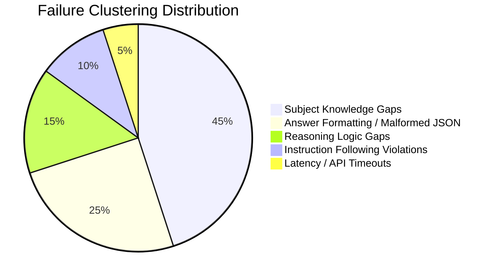
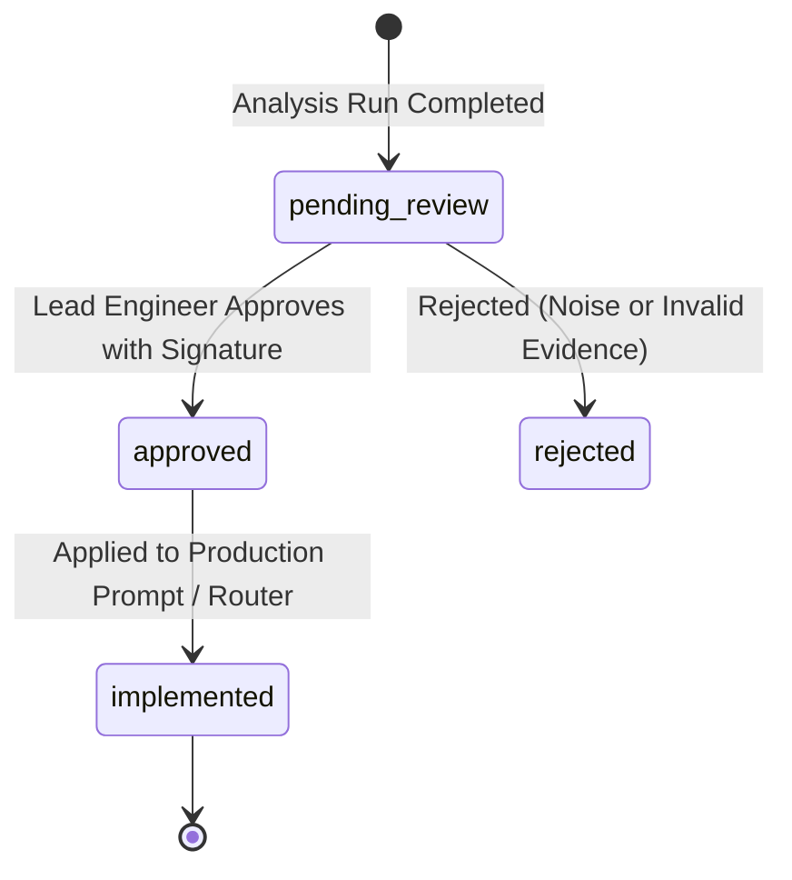

# TATTVA AI — Performance Analysis & Continuous Improvement System
**Conceptualized & Engineered by kotapati Gowtham Chowdary**

---

## 1. Overview & Problem Statement

Running evaluation benchmarks without automated failure analysis leaves developers with raw percentages (e.g., "74.2% accuracy") but no systematic path toward improvement.

The **TATTVA Performance Analysis & Improvement Engine** closes this loop by:
1. Ingesting evaluation runs and identifying every incorrect or invalid question.
2. Clustering failures into well-defined weakness categories.
3. Generating concrete, evidence-based recommendations for prompts, routing, and alignment.
4. Enforcing **Strict Human-in-the-Loop Review Governance** before any production parameter or model routing configuration is changed.

---

## 2. Failure Pattern Clustering

The analyzer (`app/lib/evaluation/improvement/failure-analyzer.ts`) partitions errors across five key failure topologies:



### Cluster Taxonomy

1. **`answer_formatting_malformed`**:
   - The model produced conversational prose, missed the required JSON schema, or omitted the option letter.
   - **Resolution**: Enforce few-shot JSON formatting examples in system prompts and expand regex fallback extraction heuristics.

2. **`subject_knowledge_gap`**:
   - The model demonstrated concentrated errors (2+ failures) in specific academic domains (e.g., `sociology`, `advanced_mathematics`).
   - **Resolution**: Adjust TATTVA Model Router rules to send queries in that subject to a higher-capacity reasoning model, or inject verified RAG context.

3. **`instruction_following_violation`**:
   - The model violated explicit constraints (e.g., word count limits, negative rules, language selection).
   - **Resolution**: Add explicit constraint reinforcement checkpoints in prompt compilers.

4. **`reasoning_logic_gap`**:
   - The model outputted well-formed text but exhibited flawed mathematical deduction or step-by-step logic errors.
   - **Resolution**: Enable multi-step chain-of-thought (CoT) reasoning conditioning.

5. **`timeout_latency_spike`**:
   - The model exceeded API latency thresholds or encountered network timeouts.
   - **Resolution**: Adjust timeout limits or enable multi-provider circuit-breaking fallbacks.

---

## 3. Human Approval Governance Workflow

To safeguard production integrity, TATTVA AI prohibits automated unvetted modifications to production prompts or routing tables:



### Review State Transitions

- **`pending_review`**: Default state upon recommendation generation.
- **`approved`**: A verified AI engineer has reviewed the supporting failure evidence and approved the proposed actionable step.
- **`rejected`**: The reviewer determined that the proposed change is unnecessary or counter-productive.
- **`implemented`**: The prompt adjustment, routing rule, or few-shot example has been merged and verified against the regression test suite.

### Supporting Evidence Structure

Every recommendation includes concrete proof linking back to the exact failure instances:
```typescript
supportingEvidence: {
  runId: "eval_1794697836865_7vyb8",
  model: "gemini-2.5-flash",
  errorCount: 3,
  sampleErrors: [
    {
      question: "समाजशास्त्र की मुख्य विशेषता क्या है?",
      expected: "B",
      actual: "C"
    }
  ]
}
```

---

## 4. Regression Prevention Framework

Before marking a recommendation as `implemented`, the engineer triggers the regression test suite:
1. Re-run the benchmark with the modified prompt or routing rule using the **exact same seed**.
2. Verify that accuracy on the weak subject has improved.
3. Confirm that accuracy on previously passed subjects has not degraded (delta $\ge 0\%$).

---
*Created by kotapati Gowtham Chowdary for TATTVA AI Foundation Ecosystem.*
