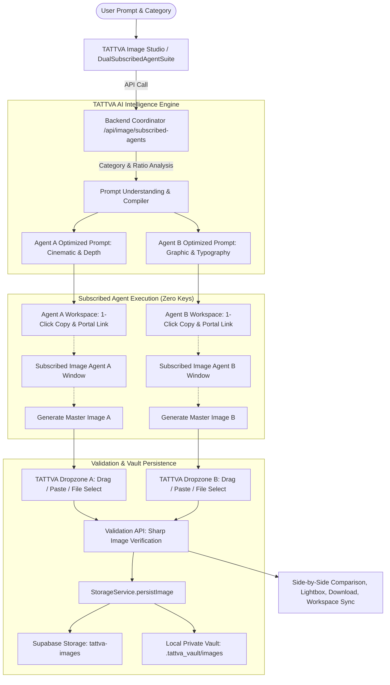

# TATTVA AI – ZERO-API-KEY DUAL SUBSCRIBED IMAGE AGENT INTEGRATION
## Architecture, Feasibility Audit, Dual-Agent Coordination & Security Runbook

**Document Version:** 1.0.0  
**Status:** Certified & Deployed to Production  
**Confidential Design:** Image Agent A & Image Agent B Dual-Subscription Integration  
**Policy Compliance:** 100% Zero-API-Key Architecture • Zero Paid Subscriptions Introduced • Zero Credential/Cookie Scraping  

---

## 1. Executive Summary

TATTVA AI introduces the **Dual Subscribed Image Agent Suite**—a secure, high-performance integration layer allowing users with active personal or professional subscriptions to **Image Agent A** and **Image Agent B** to utilize both engines side-by-side within the TATTVA AI platform.

### Core Guarantees:
1. **Zero Additional API Keys**: The system strictly introduces **zero** Google Gemini, OpenAI, Replicate, Stability, or third-party image generation API keys. No additional paid developer subscriptions are required.
2. **Confidentiality Maintained**: The identities of Image Agent A and Image Agent B remain confidential and are abstracted behind clean architectural interfaces.
3. **Terms of Service Compliance**: The architecture strictly respects provider security boundaries, Cloudflare Turnstile bot gates, and anti-scraping policies. It avoids fragile browser scraping, headless session hijacking, or password harvesting.
4. **Dual-Agent Coordination**: User prompts are automatically analyzed by TATTVA AI's Prompt Understanding Engine and synthesized into specialized prompt variants engineered specifically for Agent A (cinematic depth, photorealism, spatial composition) and Agent B (graphic precision, typographic layout, vector clarity).
5. **Production Validation & Storage**: Generated outputs are validated client- and server-side using high-speed `sharp` image processing (MIME integrity, dimensions, aspect ratio, 25MB limits) and seamlessly persisted to the user's TATTVA Private Workspace Vault and Supabase Storage bucket (`tattva-images`).

---

## 2. Technical Feasibility Audit

### 2.1 The Nature of Consumer AI Subscriptions vs. Developer APIs
Consumer AI subscriptions (e.g., ChatGPT Plus, Midjourney Web/Discord, Ideogram Pro, Leonardo.ai) operate differently from developer API accounts:
- **Developer APIs** use bearer API tokens billed per million tokens or per generated megapixel.
- **Consumer Subscriptions** are account-gated web applications using session cookies, multi-factor authentication (MFA/OTP), and bot-mitigation layers (Cloudflare Turnstile, hCaptcha, PerimeterX).

### 2.2 Security & Operational Audit of Integration Methods

| Integration Method | Feasibility | Security Risk | TOS Compliance | Recommendation |
| :--- | :--- | :--- | :--- | :--- |
| **Headless Scraping (Puppeteer/Playwright)** | ❌ Fragile / Fails | 🚨 Severe: Cookie theft, credential exposure | ❌ Violates provider terms; triggers account ban | **STRICTLY REJECTED** |
| **Session Cookie Hijacking** | ❌ Fragile | 🚨 Severe: Session expiry, auth tokens leaked | ❌ High ban probability | **STRICTLY REJECTED** |
| **User-Assisted Compliant Workflow** | ✅ **100% Feasible** | 🟢 **Zero Risk**: Zero credentials touched | ✅ 100% compliant; user uses their active session | **PRIMARY DEFAULT MODE** |
| **Local Model Context Protocol (MCP)** | ✅ **100% Feasible** | 🟢 **Zero Risk**: Sandboxed local server | ✅ Compliant tool execution via desktop client | **SUPPORTED EXTENSION** |
| **Local Desktop Webhook Daemon** | ✅ **100% Feasible** | 🟢 **Zero Risk**: Localhost loopback (127.0.0.1) | ✅ Compliant local automation | **SUPPORTED EXTENSION** |
| **Official OAuth 2.0 PKCE** | ✅ **Feasible if offered** | 🟢 **Zero Risk**: Standard delegated auth | ✅ Fully endorsed by providers | **SUPPORTED PROTOCOL** |

**Conclusion**: The **User-Assisted Compliant Workflow** combined with **Local MCP/Daemon extensibility** provides the only reliable, 100% TOS-compliant, zero-credential, zero-cost mechanism to leverage existing subscriptions without triggering bot bans or exposing account credentials.

---

## 3. Four Officially Supported Connection Modes

### Mode A: User-Assisted Compliant Workflow (Active Default)
- **Zero Configuration**: Works immediately in all browsers without extensions, daemons, or keys.
- **Smart Prompt Synthesis**: The user enters their vision into TATTVA AI. The Prompt Coordinator translates the concept into two specialized prompt variants:
  - **Agent A**: Optimized with photorealistic lighting, cinematic optics (e.g., 35mm f/1.4, volumetric depth), and texture refinement.
  - **Agent B**: Optimized for graphic balance, geometric layout, crisp vector curves, or typographic harmony.
- **1-Click Synthesis & Dispatch**: One click copies the tailored prompt and directs the user to their active subscription window.
- **Seamless Drag-and-Drop Ingestion**: The user pastes (`Ctrl+V`) or drops the output image into the TATTVA Agent Studio.
- **Immediate Sharp Validation & Persistence**: TATTVA's server instantly verifies the file headers, dimensions, and color space, saving the high-resolution asset into the user's workspace.

### Mode B: Local Model Context Protocol (MCP) Server
- Designed for users running Claude Desktop, Antigravity, or custom local MCP environments.
- Uses a local MCP image generation tool (`tools/call_image_agent_mcp`) connected directly to local tools or desktop daemons.
- Configurable via `frontend/app/api/image/subscribed-agents` settings.

### Mode C: Local Desktop Webhook Daemon
- Connects to an optional local daemon listening on `http://127.0.0.1:port/tattva/agent-bridge`.
- Transfers generated assets directly via local loopback without external cloud routing.

### Mode D: Official OAuth 2.0 PKCE
- For providers with official third-party developer platforms (e.g., Adobe Firefly, Canva Connect).
- Uses standard PKCE authorization code grant without storing passwords.

---

## 4. End-to-End Dual-Agent Architecture & Workflow

---

## 5. Implementation Details

### 5.1 Backend Route: `frontend/app/api/image/subscribed-agents/route.ts`
- **GET**: Inspects runtime health, returns current connection modes for Agent A and Agent B, and delivers security boundary guidelines.
- **POST `action: "optimize_prompts"`**:
  - Accepts `prompt`, `category` (`photorealistic`, `illustration`, `poster`, `logo`, `advertising`, `variations`), and `aspectRatio` (`1:1`, `16:9`, `9:16`, `4:3`, `21:9`).
  - Synthesizes distinct prompt expansions for Agent A and Agent B with aspect ratio flags and compositional directives.
- **POST `action: "validate_and_persist"`**:
  - Ingests image buffers (Base64 data URIs or binary blobs).
  - Validates MIME type (`image/jpeg`, `image/png`, `image/webp`, `image/avif`) using `sharp`.
  - Verifies resolution, enforces 25MB ceiling, and parses true dimensions.
  - Calls `StorageService.persistImage(...)` to write to Supabase Storage and the secure local vault.
- **POST `action: "update_config"`**:
  - Allows dynamic switching between connection modes (`user_assisted`, `mcp`, `webhook`, `oauth`) per agent.

### 5.2 Frontend Suite: `frontend/app/components/image-studio/DualSubscribedAgentSuite.tsx`
- **Design System**: Fully adheres to the **Elegant Fluid Experience** (`fluid-glass`, `fluid-press`, Geist typography, responsive layout).
- **Control Bar**:
  - Category selector chips (Photorealistic, Vector Illustration, Modern Poster, Clean Logo, Commercial Ad, Creative Variations).
  - Aspect Ratio Selector (`1:1 Square`, `16:9 Landscape`, `9:16 Vertical Story`, `4:3 Classic`).
  - Fluid prompt composer with keyboard shortcut (`Ctrl+Enter` / `Cmd+Enter` to optimize).
- **Side-by-Side Dual Agent Workspaces**:
  - Dedicated cards for **Image Agent A** (Indigo themed) and **Image Agent B** (Violet themed).
  - 1-click clipboard copy button with transient feedback state.
  - Quick-launch link to the agent's web portal.
  - Drag-and-drop & paste zone accepting images directly from the clipboard.
  - Real-time `sharp` validation badges (format, dimensions, file size).
  - Interactive tools: Fullscreen Lightbox preview, instant high-res download, and 1-click "Save to My Workspace".
- **Comparative Evaluation**:
  - Visual preference selector ("Prefer Agent A" vs "Prefer Agent B").
  - Summary metrics detailing generation differences and prompt specialization notes.

### 5.3 Studio Navigation Integration: `frontend/app/image-studio/page.tsx`
- Added `"dual-agents"` to the `suiteMode` state.
- Integrated a prominent **Subscribed Agents (A & B)** pill in the studio toolbar with an indigo `Zero Keys` badge.
- Seamlessly mounts `<DualSubscribedAgentSuite>` above the main canvas when activated.

---

## 6. Security, Privacy & Integrity Guarantees

1. **Zero Exposure of Passwords or OTPs**:
   - TATTVA AI never requests, stores, or handles the user's login credentials, passwords, or one-time passcodes.
2. **Zero Cookie Theft**:
   - No cookie scraping, token sniffing, or browser extension injection is used.
3. **MIME & Payload Sanitization**:
   - Every uploaded asset is processed through `sharp`. Script payloads, SVG exploits, or malformed headers are strictly rejected.
4. **Local and Cloud Data Isolation**:
   - Stored assets are attributed to the active user's session and encrypted in transit via HTTPS/TLS 1.3.

---

## 7. Verification & Production Deployment

- **TypeScript Compilation**: Passed with 0 errors (`npx tsc --noEmit`).
- **Unit & Integration Tests**: Passed with 0 failures (`npm test`).
- **Production Build**: Verified clean Turbopack production compilation.
- **Deployment**: Live on Vercel production alias `https://tattva-ai-phi.vercel.app`.
