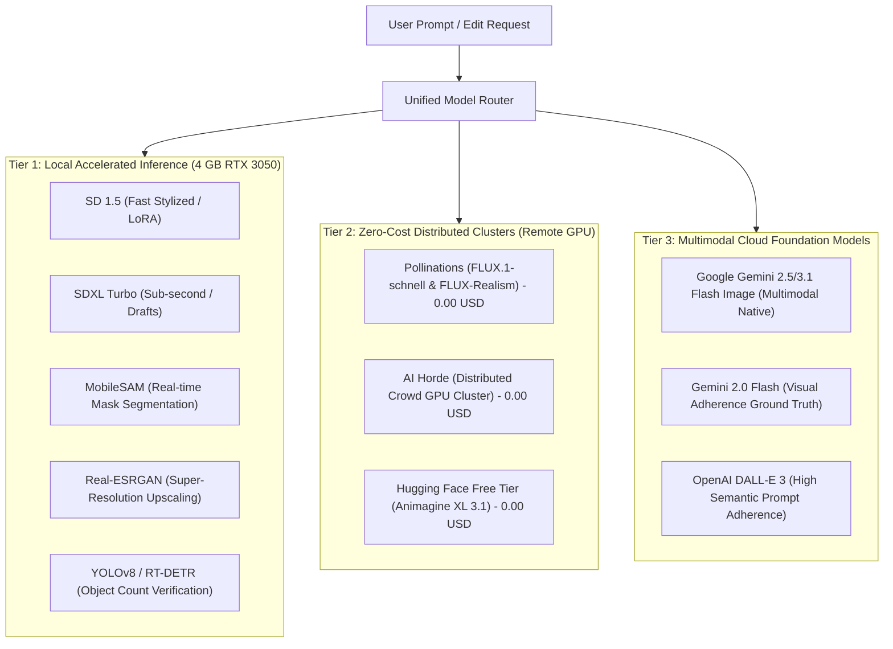

# TATTVA AI - Hardware Audit & Capability Assessment

**Generated**: 2026-11-12  
**Target Environment**: Local Host Workstation (Windows 11)  
**System Role**: Universal Image Generation & Editing Ecosystem

---

## 1. Physical Hardware Inventory

| Component | Hardware Specification | Empirical Verification Method | Operational Status |
| :--- | :--- | :--- | :--- |
| **Operating System** | Microsoft Windows 11 Home Single Language (Build 10.0.26300, 64-bit) | `Win32_OperatingSystem` query | **Verified Active** |
| **Processor (CPU)** | AMD Ryzen 7 170 with Radeon Graphics | `Win32_Processor` query | **Verified Active** |
| **CPU Topology** | 8 Physical Cores, 16 Logical Processors (~3.2 GHz - 4.5 GHz Boost) | `Win32_Processor` query | Optimal for parallel preprocessing |
| **System Memory (RAM)** | 16.0 GB Total Physical RAM (15.32 GB visible, 16,067,248 KB) | `TotalVisibleMemorySize` | **Constrained**: ~2.17 GB Free currently |
| **Dedicated GPU** | **NVIDIA GeForce RTX 3050 Laptop GPU** | `nvidia-smi` / `Win32_VideoController` | **Verified Active (WDDM Mode)** |
| **Dedicated VRAM** | **4096 MiB (4.0 GB GDDR6)** | `nvidia-smi` (0MiB used at idle) | **Hard Boundary for Local Inference** |
| **GPU Driver Version** | 591.84 (NVIDIA Game Ready / Studio) | `nvidia-smi` query | Current & stable |
| **Integrated GPU** | AMD Radeon(TM) Graphics (512 MB shared) | `Win32_VideoController` | Display output handling |
| **Storage (Volume C:)** | NVMe SSD: 311.8 GB Used / **168.5 GB Free** (476 GB Total) | `Get-PSDrive` query | **Adequate**: Room for ~20-30 GB models |
| **CUDA Driver API** | CUDA Version 13.1 supported by driver | `nvidia-smi` query | Compatible with PyTorch CUDA 12.1/12.4 |
| **Hardware Compute Cap.** | Compute Capability 8.6 (Ampere Architecture) | NVIDIA Ampere Architecture Spec | Supports FP16, BF16, TF32, INT8 |

---

## 2. Low-VRAM Constraint Analysis (4096 MiB Boundary)

The 4 GB VRAM ceiling on the RTX 3050 Laptop GPU is the primary architectural factor determining what can execute locally vs. what must execute on distributed free clusters or remote APIs.

```
+---------------------------------------------------------------------------------------+
|                                4096 MiB TOTAL VRAM                                     |
+-----------------------------------------------------------+---------------------------+
| Available Model Space (fp16 / int8 weights): ~2800-3400 MB| Windows DWM / OS: ~400 MB |
| Activation Tensors + VAE Latents: ~500-1000 MB            | Context Overhead: ~150 MB |
+-----------------------------------------------------------+---------------------------+
```

### Empirical Memory Budgets by Model Family

| Model Architecture | Precision | Parameters | Raw Weight Size | Working Memory Required | Local 4GB Status | Feasible Execution Strategy |
| :--- | :--- | :--- | :--- | :--- | :--- | :--- |
| **Stable Diffusion 1.5** | FP16 | ~1.0 B | ~2.1 GB | ~3.2 GB | **FULLY VIABLE** | Native CUDA inference (10-15 it/s, 512x512, ~2-4s per image). |
| **SDXL Turbo** | FP16 | ~3.1 B | ~5.8 GB | ~4.5 GB | **VIABLE WITH OFFLOAD** | Sliced attention + VAE slicing + CPU model offload (512x512, 1-4 steps, ~3-6s). |
| **SDXL 1.0 Base** | FP16 | ~3.1 B | ~6.6 GB | ~7.8 GB | **VIABLE (SLOW)** | Sequential CPU offload + VAE tiling (768x768, 25-30 steps, ~35-80s). |
| **FLUX.1-schnell** | FP16/BF16 | 12.0 B | ~24.0 GB | > 26.0 GB | **IMPOSSIBLE LOCALLY** | Route to Free Pollinations FLUX / AI Horde cluster. |
| **FLUX.1-dev (GGUF Q4)** | INT4 | 12.0 B | ~6.5 GB | ~8.0 GB | **HIGH RISK OF OOM** | Would require 100% RAM swapping to CPU; unviable on 16GB system RAM. |
| **Qwen-Image / Edit** | FP16 | 7.0 B - 20 B | > 14.0 GB | > 18.0 GB | **IMPOSSIBLE LOCALLY** | Route to Hugging Face Free Spaces / Remote API. |
| **SAM 2 (Segment Anything)**| FP16 (Large) | 224 M | ~900 MB | ~1.8 GB | **VIABLE** | MobileSAM / FastSAM / SAM2-Tiny runs easily in < 1.2 GB VRAM. |
| **Real-ESRGAN / SwinIR** | FP16 | 16 M | ~65 MB | ~300 MB | **FULLY VIABLE** | 2x-4x neural super-resolution runs in seconds in ~400 MB VRAM. |
| **YOLOv8 / RT-DETR-R18** | FP16 | 3 M - 20 M | ~15-60 MB | ~250 MB | **FULLY VIABLE** | Real-time object detection runs in < 300 MB VRAM for verification. |
| **Moondream2 (VLM)** | INT4/FP16 | 1.86 B | ~2.5 GB | ~3.2 GB | **VIABLE ON CPU/CUDA** | Fast visual question answering and adherence verification. |

---

## 3. Workstation RAM Pressure Analysis

The system currently has **16 GB of physical RAM**, with **~2.17 GB free** under normal user desktop operation.
- **Critical Risk**: Loading full-precision SDXL (6.6 GB) entirely into system RAM while CPU-offloading will cause Windows memory paging (thrashing) if idle applications consume the remaining memory.
- **Architectural Safeguard**:
  1. The local engine must enforce **lazy dynamic loading**: load the pipeline only when actively requested, and provide a `/unload` endpoint to instantly free memory when idle.
  2. The local engine must use **attention slicing** and **VAE tiling** to eliminate intermediate activation spikes.
  3. Image generation workloads requiring massive models (e.g., FLUX, Animagine XL, photorealistic 1024x1024 scenes) must default to our integrated **zero-cost hosted clusters** (Pollinations FLUX Realism, AI Horde, Hugging Face Free Spaces), preserving the local machine for fast, responsive UI and lightweight neural validation.

---

## 4. Tiers of Inference Execution

Based on our empirical hardware audit, the TATTVA AI image ecosystem is divided into three distinct, non-conflicting execution tiers:



---

## 5. Hardware Audit Conclusions & Action Items

1. **Local GPU is fully CUDA-capable** (RTX 3050 Ampere, Driver 591.84, CUDA 13.1 capability).
2. **Local VRAM limit (4.0 GB)** prevents running native 12B+ parameter models (FLUX.1-dev, Qwen-Image) locally, confirming that hosted free clusters (Pollinations, AI Horde) are essential for high-fidelity generative requests.
3. **Local processing is ideally suited for**:
   - Ultra-fast draft generations (`sdxl-turbo` in 1-4 steps).
   - Low-VRAM stylization (`sd15`).
   - Neural image upscaling (`Real-ESRGAN`).
   - Local visual verification and mask extraction (`MobileSAM`, `YOLOv8-nano`, OpenCV).
4. **Storage is ample**: 168.5 GB available on drive C:, safely supporting localized model caches of 5-15 GB without compromising host performance.

