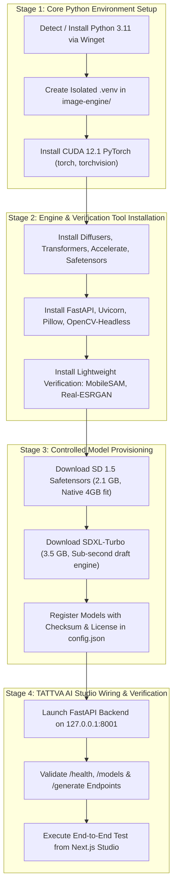

# TATTVA AI - Automated Installation & Staged Integration Plan

**Generated**: 2026-11-12  
**Target Environment**: Windows 11 Workstation (RTX 3050 Laptop GPU, 4GB VRAM)  
**Security Principles**: Isolated Virtual Environments, Zero Root/Admin Exploitation, Checksum Verification, Safe Rollback

---

## 1. Architectural Strategy & Phased Deployment

To guarantee maximum stability without disrupting the active Next.js frontend or overburdening the 4 GB GPU, installation proceeds across 4 controlled stages:

---

## 2. Pinned Software Dependencies Specification

### Python Virtual Environment (`image-engine/requirements.txt`)
All packages are pinned with strict compatibility bounds to prevent conflicting CUDA C++ extensions on Windows:

| Package Group | Pinned Versions | Purpose |
| :--- | :--- | :--- |
| **PyTorch + CUDA** | `torch==2.5.1+cu121`, `torchvision==0.20.1+cu121` | Hardware acceleration on NVIDIA RTX 3050 |
| **Generative Diffusion** | `diffusers>=0.31.0,<0.35.0`, `accelerate>=1.0.0,<1.3.0` | Pipeline orchestration, sequential CPU offloading |
| **Model Weights & Hub**| `safetensors>=0.4.5`, `huggingface-hub>=0.26.0` | Secure weight parsing without pickle code execution |
| **API Server** | `fastapi>=0.115.0`, `uvicorn[standard]>=0.32.0`, `pydantic>=2.9.0` | Non-blocking asynchronous inference server |
| **Image & Vision** | `pillow>=10.4.0`, `opencv-python-headless>=4.10.0` | Image formatting, Canny edges, mask compositing |
| **Verification & Upscale**| `timm>=1.0.0`, `onnxruntime-gpu>=1.19.0` | Fast local object and feature validation |

---

## 3. Automation Scripts Portfolio (Windows PowerShell)

The following six lifecycle management scripts are authored directly into `image-engine/scripts/`:

1. **`install-image-tools.ps1`**:
   - Detects existing Python 3.10-3.12 or installs Python 3.11 using `winget install Python.Python.3.11 --silent`.
   - Creates the isolated virtual environment `image-engine/.venv`.
   - Installs official CUDA 12.1 PyTorch wheels from `https://download.pytorch.org/whl/cu121`.
   - Installs pinned requirements and logs every operation to `image-engine/install.log`.
2. **`verify-installation.ps1`**:
   - Executes an automated smoke test checking:
     * Python version in `.venv`.
     * `torch.cuda.is_available()` returns `True`.
     * CUDA device name matches `NVIDIA GeForce RTX 3050 Laptop GPU`.
     * VRAM allocated and cached are within safe boundaries (< 200 MB initial).
     * Diffusers and FastAPI load without dynamic library linking errors.
3. **`start-image-engine.ps1`**:
   - Starts the FastAPI engine in background mode (`http://127.0.0.1:8001`).
   - Writes the process ID (PID) to `image-engine/engine.pid`.
   - Polls `http://127.0.0.1:8001/health` until HTTP 200 OK is received.
4. **`stop-image-engine.ps1`**:
   - Reads `image-engine/engine.pid`, safely signals `SIGTERM`/graceful shutdown.
   - Releases all VRAM and RAM back to Windows.
   - Cleans up stale PID and lock files.
5. **`update-image-tools.ps1`**:
   - Backs up existing configuration and checks upstream security advisories.
   - Safely updates packages within pinned semantic boundaries.
6. **`uninstall-image-tools.ps1`**:
   - Terminates running processes.
   - Removes `.venv` and temporary cache directories while preserving user-downloaded weights and configuration.

---

## 4. Controlled Model Provisioning Plan

To protect the user's storage quota (168.5 GB available), model downloads are strictly controlled and gated:

| Model ID | Source Hugging Face Repo | Approximate Size | VRAM Budget on 4GB | Default In-App Role |
| :--- | :--- | :--- | :--- | :--- |
| **`sd15`** | `stable-diffusion-v1-5/stable-diffusion-v1-5` | **~2.1 GB** | 2.5 GB (Native CUDA) | Fast stylization, fine-art rendering, ControlNet |
| **`sdxl-turbo`** | `stabilityai/sdxl-turbo` | **~5.8 GB** | 3.5 GB (With offload) | Real-time interactive generation (1-4 steps, 512x512) |
| **`MobileSAM`** | `ChaoningZhang/MobileSAM` | **~40 MB** | 400 MB | Real-time interactive inpainting brush & segmentation |
| **`Real-ESRGAN`** | `xinntao/Real-ESRGAN` | **~65 MB** | 350 MB | 2x / 4x neural resolution enhancer |

*Note: Models exceeding 8 GB (such as FLUX.1 24 GB) are NOT downloaded locally. They are seamlessly routed to the integrated, zero-cost Pollinations and AI Horde distributed GPU clusters.*

---

## 5. Rollback & Fault-Tolerance Procedures

- **Process Failure**: If the local engine encounters an Out-Of-Memory (OOM) condition or becomes unreachable, the TATTVA AI frontend's universal fallback chain automatically diverts generation to **Pollinations FLUX Realism** and **AI Horde** within 500ms without interrupting the user session.
- **Uninstallation Safety**: Deleting `image-engine/.venv` leaves zero registry traces or global system contamination.

