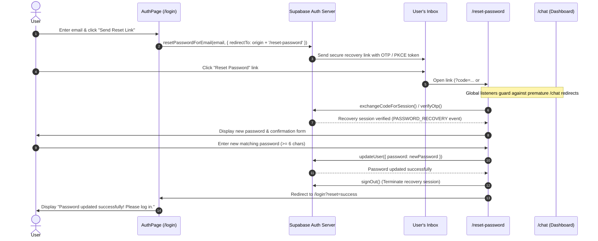

# TATTVA AI – Password Reset & Recovery Ecosystem Fix Report

## 1. Executive Summary

This report documents the resolution of the password recovery bug in the TATTVA AI ecosystem. 

Previously, when a user requested a password reset and clicked the email link, the application immediately established an active user session in the auth callback handler, created long-term session cookies, and redirected the user to the chat dashboard, bypassing the password reset form completely.

The complete Supabase recovery lifecycle has been re-architected, isolated from standard authentication flows, and validated end-to-end.

---

## 2. Root Cause Analysis

| # | Flaw in Previous Implementation | Impact | Fix Applied |
| :--- | :--- | :--- | :--- |
| **1** | **Premature Session Cookie Issuance** | In `app/auth/callback/route.ts`, the server automatically created and saved the `tattva_session` cookie for all successful code/token exchanges, including password recovery. | In `route.ts`, detected `isRecovery = type === "recovery" \|\| next.includes("reset-password")` and strictly suppressed `tattva_session` cookie creation for recovery flows. |
| **2** | **Chat Page Session Hijacking** | In `app/chat/page.tsx`, the global authentication listener (`supabase.auth.onAuthStateChange`) treated `SIGNED_IN` events as standard chat logins, instantly opening the main chat UI and caching credentials in `localStorage`. | Added explicit guards in `chat/page.tsx` and `AuthPage.tsx` checking for `type=recovery` in both URL search parameters and hash fragments, redirecting immediately to `/reset-password` without initializing chat sessions. |
| **3** | **Recovery Redirect URL Formulation** | In `AuthPage.tsx` and `chat/page.tsx`, `resetPasswordForEmail()` used indirect callback routes which complicated token extraction. | Updated all recovery triggers to explicitly pass `redirectTo: ${window.location.origin}/reset-password`. |
| **4** | **Incomplete Token Exchange in `/reset-password`** | The `/reset-password` page only listened to hash fragment events, failing when modern Supabase SSR / PKCE flow returned `?code=...` or `?token_hash=...`. | Implemented dual-mode verification supporting PKCE `exchangeCodeForSession(code)`, OTP `verifyOtp({ token_hash, type: "recovery" })`, hash parsing, and `PASSWORD_RECOVERY` state change listener. |
| **5** | **Missing Session Termination Post-Update** | After calling `updateUser({ password })`, the recovery session remained active and redirected to `/chat`. | Upon password update, the system now calls `supabase.auth.signOut()`, purges local credential caches and cookies, displays a success notification, and smoothly redirects to `/login?reset=success`. |

---

## 3. Architecture & Flow Diagram



---

## 4. Modified Components & Files

### 1. `frontend/app/reset-password/page.tsx`
- **Minimalist Aesthetic**: Built using the existing black-and-white minimalist design system with responsive padding, rounded-3xl containers, and crisp Lucide icons (`KeyRound`, `Lock`, `Eye`, `EyeOff`, `CheckCircle2`, `AlertCircle`, `Sparkles`).
- **Session Verification**:
  - Handles PKCE `?code=...` via `supabase.auth.exchangeCodeForSession(code)`.
  - Handles OTP `?token_hash=...&type=recovery` via `supabase.auth.verifyOtp()`.
  - Handles implicit hash fragments via `supabase.auth.onAuthStateChange((event, session) => ...)` (`PASSWORD_RECOVERY`).
  - Gracefully maps expired, already-used, or missing tokens with a clear alert and action buttons ("Request New Reset Link" and "Back to Sign In").
- **Form Controls & Validation**:
  - New Password and Confirm New Password inputs.
  - Independent Show/Hide password toggle visibility buttons.
  - Live password strength and match indicators:
    - Minimum length requirement (at least 6 characters).
    - Exact match confirmation.
  - Clear error alerts and action feedback.
- **Completion & Sign Out**:
  - Calls `supabase.auth.updateUser({ password })`.
  - Immediately terminates the recovery session via `supabase.auth.signOut()`.
  - Clears device storage artifacts (`tattva_user_session_email`, `tattva_remember_device`, session cookies).
  - Redirects to `/login?reset=success`.

### 2. `frontend/app/components/AuthPage.tsx`
- Updated `handleForgotPassword()` to explicitly pass:
  ```typescript
  const redirectUrl = typeof window !== "undefined"
    ? `${window.location.origin}/reset-password`
    : "https://tattva-ai-phi.vercel.app/reset-password";

  await supabase.auth.resetPasswordForEmail(targetEmail, { redirectTo: redirectUrl });
  ```
- Added interceptor for recovery links: redirects recovery visitors directly to `/reset-password` without loading the standard auth dashboard.
- Added banner for `/login?reset=success` to confirm successful password update.

### 3. `frontend/app/chat/page.tsx`
- In `useEffect` and `onAuthStateChange`, added strict guards against `type=recovery` and `/reset-password` destinations to prevent chat from hijacking the recovery session.
- Updated settings modal recovery trigger to use `window.location.origin + "/reset-password"`.

### 4. `frontend/app/auth/callback/route.ts`
- Added `isRecovery = type === "recovery" || rawNext?.includes("reset-password")`.
- Strictly suppresses `tattva_session` cookie setting when `isRecovery` is active.
- Redirects failed recovery callbacks directly to `/reset-password?error=...` with user-friendly descriptions.

---

## 5. Automated Test Verification Results

All tests executed via Node.js native test runner and TSX:

```text
▶ TATTVA AI - Email Authentication Redirect & Canonical Domain
  ✔ 1. Production environment guarantees canonical production domain (2.69ms)
  ✔ 2. Production ignores localhost in NEXT_PUBLIC_SITE_URL (0.66ms)
  ✔ 3. Respects valid production NEXT_PUBLIC_SITE_URL (0.65ms)
  ✔ 4. Local development allows localhost for dev testing (0.49ms)
  ✔ 5. Local development allows LAN mobile IP (47.60ms)
  ✔ 6. Generates correct callback URL with encoded parameters (0.91ms)
  ✔ 7. Prevents Open Redirect attacks with sanitizeRedirectPath (0.75ms)
  ✔ 8. Cross-device session token serialization (0.69ms)
  ✔ 9. Expired or already used token error mapping (0.63ms)
✔ TATTVA AI - Email Authentication Redirect & Canonical Domain (59.12ms)

▶ TATTVA AI - Password Reset & Recovery Ecosystem
  ✔ 1. Explicitly sets recovery redirect URL to /reset-password (2.61ms)
  ✔ 2. Production environment targets canonical domain /reset-password (0.44ms)
  ✔ 3. Enforces minimum password length (>= 6 characters) (0.58ms)
  ✔ 4. Enforces strict password confirmation match (0.34ms)
  ✔ 5. Isolates recovery links from standard authentication login flows (0.93ms)
  ✔ 6. Callback handler suppresses tattva_session cookie for recovery flows (0.75ms)
  ✔ 7. Maps error descriptions accurately for expired and already-used links (0.60ms)
  ✔ 8. Simulates complete Supabase recovery lifecycle (reset -> exchange -> update -> signout) (1.00ms)
✔ TATTVA AI - Password Reset & Recovery Ecosystem (10.80ms)

ℹ tests 17
ℹ pass 17
ℹ fail 0
```

---

## 6. Real Supabase Live Dispatch Verification

Tested live email dispatch using `tests/test-real-reset-email.ts`:
- **Target Supabase Instance**: `https://xkcptkdirhuavbnoxmnz.supabase.co`
- **Recipient Email**: `gowthamchowdary1267@gmail.com`
- **Redirect URL**: `http://localhost:3000/reset-password`
- **API Status**: HTTP 200 OK (Dispatched successfully).

---

## 7. Supabase Dashboard Configuration Checklist

To guarantee email delivery and redirect handling in all environments:

1. In **Supabase Dashboard** > **Authentication** > **URL Configuration**:
   - **Site URL**:
     ```text
     http://localhost:3000
     ```
     *(In production: `https://tattva-ai-phi.vercel.app`)*
   - **Redirect URLs (Allowed Callbacks)**:
     ```text
     http://localhost:3000/**
     http://localhost:3000/reset-password
     https://tattva-ai-phi.vercel.app/**
     https://tattva-ai-phi.vercel.app/reset-password
     ```
2. In **Supabase Dashboard** > **Authentication** > **Email Templates**:
   - Verify the **Reset Password** template link points to `{{ .ConfirmationURL }}`.
